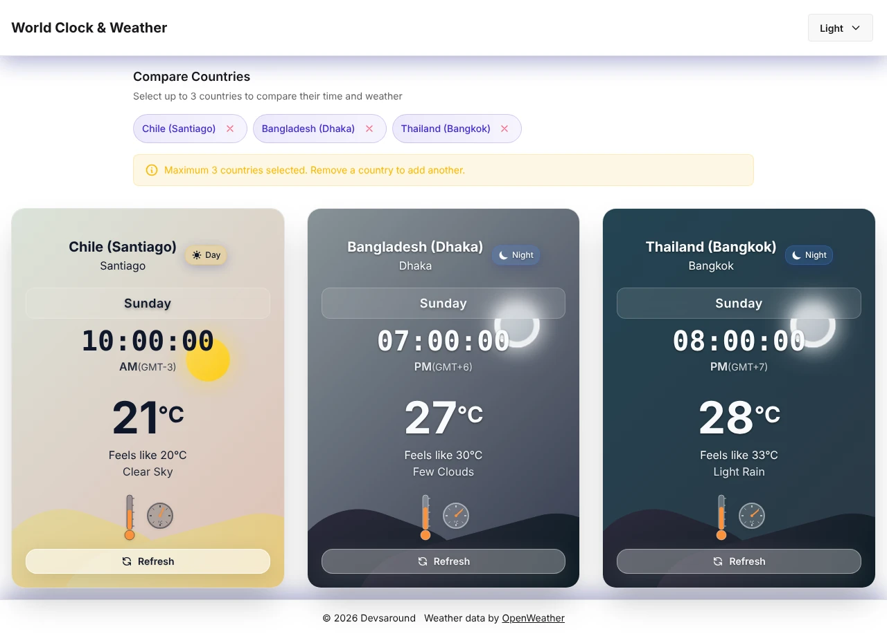
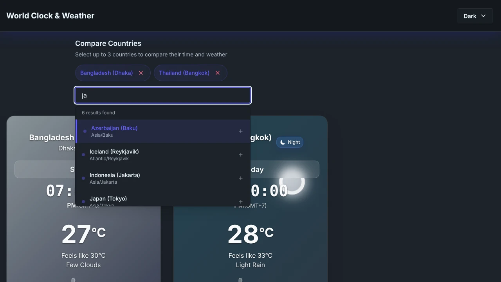
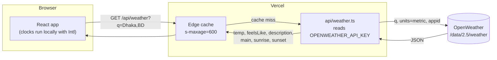

# World Clock & Weather

Local time and current weather for up to three cities, side by side, each on a sky that follows the city's own day and night.

[](https://github.com/tahmidbintaslim/Clock-Weather-App/actions/workflows/ci.yml)
[](LICENSE)
[](https://clock-weather-app-six.vercel.app/)

**Live demo:** [clock-weather-app-six.vercel.app](https://clock-weather-app-six.vercel.app/)



<sub>Screenshots are from a local build with sample weather values and a fixed clock, so they stay reproducible. The live demo shows real OpenWeather data.</sub>

## Features

- Clocks for up to 3 cities, updated every second, with the weekday and the UTC offset. Offsets that are not whole hours show correctly, for example GMT+5:30 (New Delhi) and GMT+4:30 (Kabul).
- A search box over 87 countries, one city each (mostly capitals). Arrow keys and Enter pick a result.
- Your cities are saved in the browser and in the page URL, so a reload keeps them and the link can be shared (see [Sharing a set of cities](#sharing-a-set-of-cities)).
- Current temperature, "feels like" temperature and conditions per city, with a thermometer and a gauge.
- Day or night per city from OpenWeather's sunrise and sunset times. Until weather loads, 06:00 to 18:00 local time counts as day.
- Animated overlays for rain, drizzle, thunderstorm, snow, clouds, mist, fog, haze and smoke; sun rays on a clear day and stars on a clear night.
- A Refresh button on each card.
- 5 daisyUI themes (light, dark, cupcake, corporate, synthwave). Your choice is saved in the browser.
- The OpenWeather API key stays on the server. The browser only calls this app's `/api/weather` function.
- Without an API key the clocks still run, and each weather card shows a setup hint.



## Tech stack

| Area | Choice |
| --- | --- |
| UI | React 19, TypeScript 5.8 (strict) |
| Build and dev server | Vite 7 |
| Styling | Tailwind CSS 4 with daisyUI 5 themes |
| Weather data | [OpenWeather](https://openweathermap.org/) Current Weather API |
| API | One Vercel function, `api/weather.ts` (Web `Request` to `Response` handler) |
| Tests | Node's built-in test runner (`node --test`), 56 tests |
| Lint | ESLint 9 with typescript-eslint and the React Hooks plugin |
| Hosting | Vercel |

## Architecture



- **Clocks** never touch the network. Each card formats the current instant with `Intl` for the city's IANA time zone.
- **Weather** goes through `api/weather.ts`, which:
  - accepts exactly one query parameter, `q`, and only for the 87 cities the picker offers, so it is not an open OpenWeather proxy (a test keeps the allowlist and the picker in sync);
  - returns only the six fields the UI uses, and never logs or returns the key;
  - sets `Cache-Control: public, max-age=0, s-maxage=600, stale-while-revalidate=60` on success (on an answer served from the memo below, `s-maxage` is shortened by that answer's age), `public, max-age=0, s-maxage=600` on a 404, and `no-store` on every other error;
  - keeps each city's answer in memory per function instance (10 minutes for a good answer or a 404, 30 seconds for a failure), so respelled URLs that skip the CDN copy still cost at most one OpenWeather call per city, per instance, every 10 minutes;
  - answers `400` (bad input), `404` (OpenWeather has no such city), `405` (not GET), `502` (OpenWeather error or timeout after 8 s) and `503` (key not set).
- **Local development** uses the same handler: a small Vite plugin in `vite.config.ts` mounts it on `npm run dev` and `npm run preview`, so you don't need the Vercel CLI.

## Getting started

### Prerequisites

- Node.js 22.18 or later (`.nvmrc` pins 22). Vite 7 needs 20.19+ or 22.12+, and `npm test` runs TypeScript test files with Node's built-in type stripping, which is on by default from 22.18.
- npm 10 or later (ships with Node 22).
- An OpenWeather API key for live weather. A free key is available at [openweathermap.org/api](https://openweathermap.org/api). Without one, the app still runs and the cards show a setup hint.

### Install and run

```bash
git clone https://github.com/tahmidbintaslim/Clock-Weather-App.git
cd Clock-Weather-App
npm ci

# Put your key in OPENWEATHER_API_KEY. .env.local is git-ignored.
cp .env.example .env.local

npm run dev          # http://localhost:5173, including /api/weather
```

Check the API on its own with `curl "http://localhost:5173/api/weather?q=Dhaka,BD"`. With the placeholder key it answers `503 {"code":"not_configured",...}`; with a real key it returns the weather JSON.

### Test and build

```bash
npm run lint         # ESLint
npm run type-check   # TypeScript for the app, api/ and the tests
npm test             # 56 unit tests: the function, the memo, offsets, day/night, saved cities
npm run build        # Type-check and build to dist/
npm run preview      # Serve dist/ on http://localhost:4173, including /api/weather
```

CI (`.github/workflows/ci.yml`) runs the same steps on every push and pull request to `main`, then fails the run if a dummy key or a direct `api.openweathermap.org` call shows up in `dist/`.

### Environment variables

| Variable | Read by | Required | Notes |
| --- | --- | --- | --- |
| `OPENWEATHER_API_KEY` | The server only: `api/weather.ts` on Vercel, and the Vite dev and preview servers locally | No | Without it, or with the `.env.example` placeholder, `/api/weather` answers 503 and the cards show a setup hint. Never add a `VITE_` prefix: Vite copies `VITE_` variables into the public bundle. |

## Sharing a set of cities

The address bar always holds the cities on screen, for example:

```
https://clock-weather-app-six.vercel.app/?cities=Dhaka,BD;Bangkok,TH;Santiago,CL
```

Each entry is a `city` value from `src/data/countries.ts`, separated by semicolons. Matching ignores case, unknown entries and repeats are skipped, and only the first 3 known cities are used. A link takes priority over the list saved in the browser, and then becomes the saved list.

## Deployment

The live demo is a Vercel project connected to this repository. Vercel builds `main` to production at [clock-weather-app-six.vercel.app](https://clock-weather-app-six.vercel.app/) and builds a preview deployment for each pull request. It detects Vite, serves `dist/` as static files and deploys `api/weather.ts` as a Node.js function, so there is no `vercel.json`.

To deploy your own copy:

1. [](https://vercel.com/new/clone?repository-url=https://github.com/tahmidbintaslim/Clock-Weather-App&env=OPENWEATHER_API_KEY&envDescription=OpenWeather%20API%20key%2C%20read%20only%20by%20the%20api%2Fweather%20function&envLink=https://openweathermap.org/api), or import the repository in the Vercel dashboard.
2. Set `OPENWEATHER_API_KEY` in Project Settings > Environment Variables, for Production and Preview.
3. Redeploy, then open `/api/weather?q=Dhaka,BD` on your deployment. It should return JSON with `feelsLike`, `sunrise` and `sunset`.

Upgrading a deployment of an older version: earlier builds read `VITE_OPEN_WEATHER_API_KEY` in the browser, which copied the key into the public JavaScript. Delete that variable, rotate the key in your OpenWeather account, and set the new key as `OPENWEATHER_API_KEY`.

Other hosts: `dist/` is a static site, but weather needs `/api/weather`. Port `api/weather.ts` (a standard `Request` to `Response` handler with no local imports) to that host's functions, or the cards show "Weather unavailable".

## Project structure

```
api/weather.ts        Vercel function: validated, cached OpenWeather proxy
src/
  App.tsx             Page layout, cards, theme menu
  components/         City picker, temperature meter, error boundary, ui/ (shadcn/ui primitives)
  assets/             Weather overlay components (rain, snow, clouds, mist, sun rays)
  data/countries.ts   The 87 cities and their IANA time zones
  lib/                Browser client for /api/weather, time helpers, saved cities
tests/                Unit tests (node --test)
docs/images/          README screenshots
```

## Status and roadmap

This is a personal project: a small, complete app rather than a product. It has no accounts, no database and no analytics. What works today is listed under Features. Known limits:

- Up to 3 cities, Celsius only, 12-hour clock, current conditions only (no forecast).
- A copy cached by the CDN can be up to about 11 minutes old.
- `/api/weather` has no per-visitor rate limit; the city allowlist and the cache are what keep OpenWeather usage bounded.
- Adding a city refetches weather for every card instead of only the new one.
- The animations do not yet respect `prefers-reduced-motion`, and the city search is not yet an ARIA combobox.

Possible next steps, in rough order: fetch only the added city, reduced-motion support, an accessible combobox for the search, then °C/°F and 12/24-hour toggles.

## Contributing

Issues and pull requests are welcome. Before opening a pull request, run `npm run lint`, `npm run type-check`, `npm test` and `npm run build`; CI runs the same checks. If you add a city to `src/data/countries.ts`, add the same `city` value to `ALLOWED_CITIES` in `api/weather.ts`, or the tests fail.

## License

MIT. See [LICENSE](LICENSE).

Weather data by [OpenWeather](https://openweathermap.org/).
